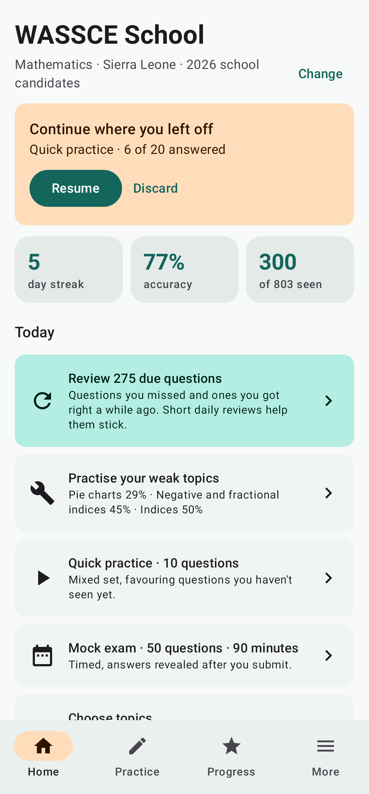
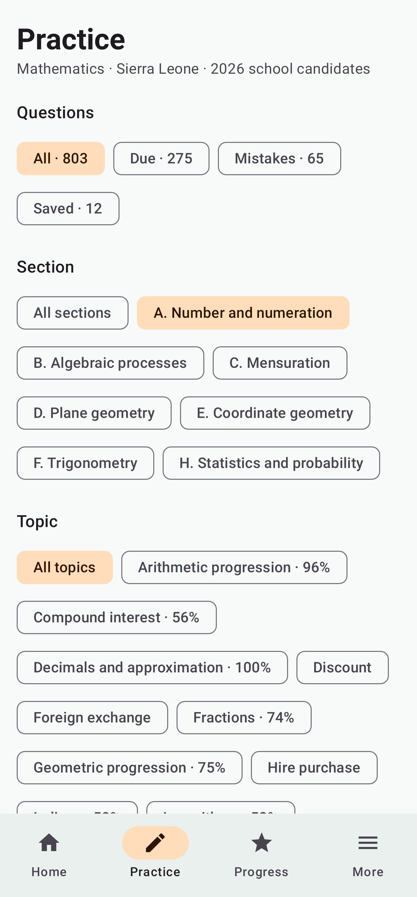
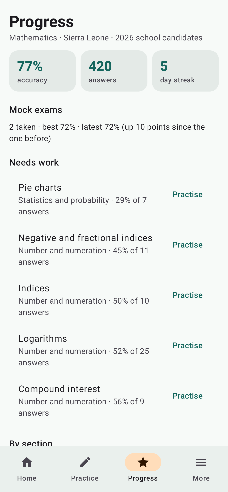
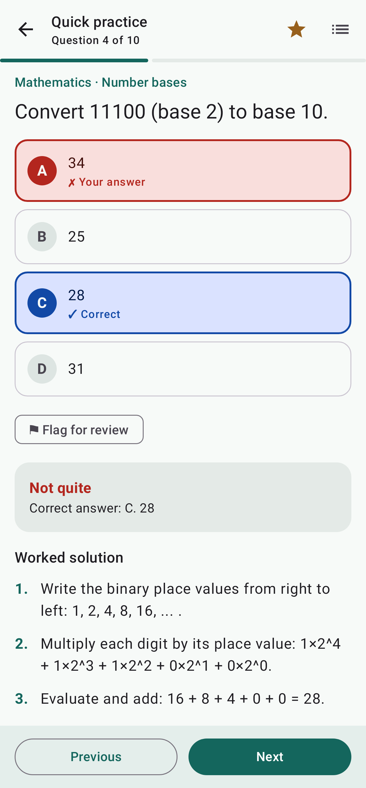
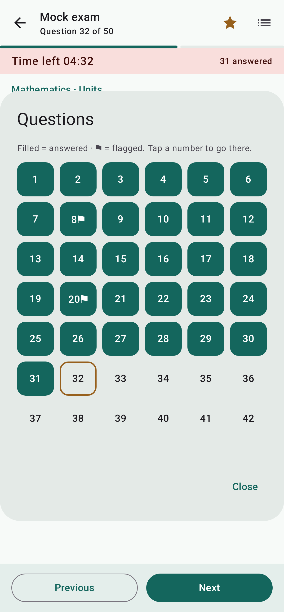
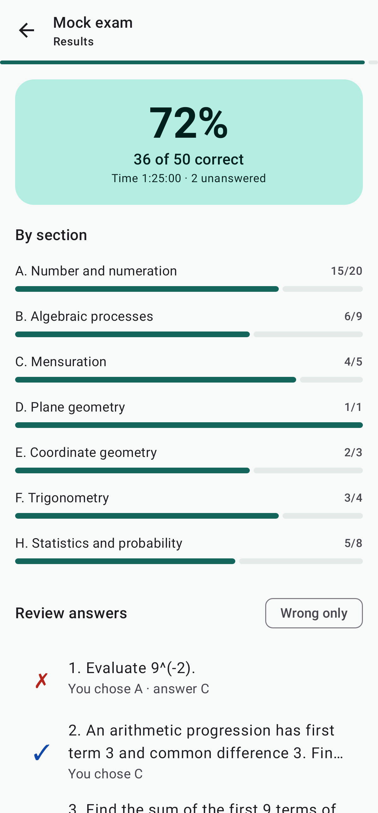

# WASSCE School

Native Android mathematics practice app with 1,000 original multiple-choice questions and 3,030 numbered solution steps. Built with Kotlin and Jetpack Compose.

## First version

- Offline topic and section practice, up to 20 questions per session.
- 50-question, 90-minute mock exams; answers are withheld until submission.
- Correct answers with solutions revealed one step at a time or all together.
- Bookmarks, retry mistakes, and local attempt/correct totals.
- Saved sessions survive app restarts. Timed exams continue counting down while away.
- One question per skill family per session to reduce repetitive variants.
- Optional country-marked topics; 803 unmarked and 197 marked questions.

This is original practice material, not official WAEC past questions. Country-symbol eligibility and question quality require local teacher review before publication. The bank reflects the uploaded syllabus, not a claim that it is the latest edition. Drawings, plots and interactive construction exercises are not included.

## Download

Get the latest app from **[Releases](https://github.com/baimasonga/WASSCE-School/releases/latest)**, or directly: <https://github.com/baimasonga/WASSCE-School/releases/latest/download/WASSCE-School.apk>. Open the file on an Android 8.0+ phone and allow installs from your browser when asked. Releases are signed with one permanent key, so new versions install over old ones and keep progress. Earlier *test* builds (CI artifacts) were signed with throwaway keys: uninstall them before installing a release.

### Publishing a release (maintainers)

1. Bump `versionCode` and `versionName` in `app/build.gradle.kts` and merge to `main`.
2. Actions → **Android release** → Run workflow. It tests, builds and signs the APK, then publishes release `v<versionName>` with `WASSCE-School.apk` attached. The website's download button always points at the latest release.

The workflow needs four repository secrets: `ANDROID_KEYSTORE_BASE64`, `ANDROID_KEYSTORE_PASSWORD`, `ANDROID_KEY_ALIAS`, `ANDROID_KEY_PASSWORD`. Keep an offline backup of the keystore: if it is lost, no future version can update existing installs.

## Website

`web/` is the WASSCE School website: practice, mock exams, progress, the Chemistry lab and app downloads, running on Cloudflare Workers + D1 with Supabase sign-in. See [web/README.md](web/README.md) and [web/DEPLOY.md](web/DEPLOY.md).

## Build

Requires JDK 17, Gradle 8.9, and Android SDK 35. Open the project in Android Studio, install the SDK if prompted, and sync Gradle. The project currently uses an installed Gradle distribution; no binary Gradle wrapper is committed.

```sh
python3 scripts/validate_bank.py
gradle testDebugUnitTest lintDebug assembleDebug
```

Debug APK: `app/build/outputs/apk/debug/app-debug.apk`.

The **Android debug APK** GitHub Actions workflow performs these checks and uploads a test APK as `WASSCE-School-debug`. Each test build uses a throwaway signing key, so use [Releases](https://github.com/baimasonga/WASSCE-School/releases/latest) for installs you want to keep updating.

## Data and privacy

The bundled JSON contains stable question IDs, four option keys, answer keys, family IDs, scope flags, and ordered solution_steps. Answers are always compared using original option keys. All 1,000 questions are bundled and need no network access. Progress, bookmarks and sessions use private SharedPreferences; there is no server, advertising SDK, login, or internet permission. Uninstalling the app removes progress; Android backup is disabled. The SQLite seed prepared in the content package is not needed by this version.

## Validation status

The content contract is validated by the included Python script. JVM tests exercise session selection. An Android build must pass CI, followed by phone testing, before treating the app as ready. Remaining checks include screen readers, large fonts, process death, exam expiry, and install/upgrade testing. Source code has no declared open-source license yet.

## Version 0.2.0

Checked wrong options now use red text/borders and a pale red background; correct options use blue. Text labels and symbols supplement color. Mock exams reveal feedback only after submission.

Import WASSCE School JSON packs from Downloads, preview before installation, choose a pack to study, and remove downloaded packs from the library. See [Question pack format](docs/QUESTION_PACKS.md) and [sample download](examples/sample-question-pack.json). Imports persist offline and are validated before atomic installation. Subscriptions, payment verification and signed entitlements are not implemented by this importer.

## Android v0.4.0: offline Chemistry simulator

Tap **Chemistry lab • offline simulator** on the study home screen. The supplied lab, missions, notebook and timed practical ship inside the APK. Rotate for a wider bench. Completed mock summaries stay on the phone; the current experiment restarts after closing. Online class features open separately in your browser. See [Android lab details](docs/ANDROID_CHEMISTRY_LAB.md).

## Android v0.5.0: redesigned study app

- **Navigation:** Home, Practice, Progress and More tabs replace the single long screen. Your exam profile (country, subject, year, candidates) and question packs now live under More.
- **Home:** resume or discard a saved session, day streak, accuracy and questions seen, plus one-tap actions: review due questions, practise weak topics, quick 10-question practice, mock exam, and the Chemistry lab.
- **Smarter practice:** practice sets put past mistakes first, then questions due for spaced review (1, 3, 7, 16 and 35 days after correct answers; immediately after wrong ones), then unseen questions. Filter by section and topic with chips, choose 10/20/30 questions, or practise only saved, mistaken or due questions. Practice now scores only the questions you answer; skipped ones no longer count as wrong.
- **Progress:** accuracy, answers and streak; weak topics (at least 3 answers, under 70% correct) with a Practise button; coverage and accuracy by section and topic; mock-exam trend and recent session history.
- **Exam experience:** confirm before submitting (with unanswered and flagged counts), a question grid to jump anywhere, flag questions for review, a time-left bar that turns red in the last 5 minutes, and a results screen with percentage, time taken, section breakdown and a wrong-only answer review.
- Follows the phone's light or dark theme. Progress from v0.4 carries over; questions answered before this version start out due for review.

## Screenshots

`docs/screenshots/` holds renders of the main screens, made on the JVM with Robolectric and Roborazzi from sample progress data (no emulator needed). Regenerate them after UI changes:

```sh
gradle testDebugUnitTest -Pscreenshots -ProbolectricRepo=https://maven-central.storage-download.googleapis.com/maven2
```

Without `-Pscreenshots` the screenshot tests are skipped, so normal test runs and CI stay fast. `-ProbolectricRepo` is optional; it sends Robolectric's large runtime download to Google's mirror of Maven Central, which avoids Central's per-IP download limit on shared networks. The **Android screenshots** workflow (Actions tab → Run workflow) renders them in CI and uploads them as an artifact.

| Home | Practice | Progress | Answer checked | Mock exam grid | Results |
|---|---|---|---|---|---|
|  |  |  |  |  |  |
